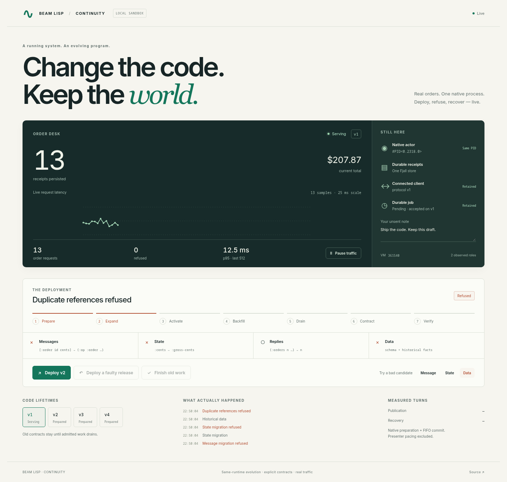
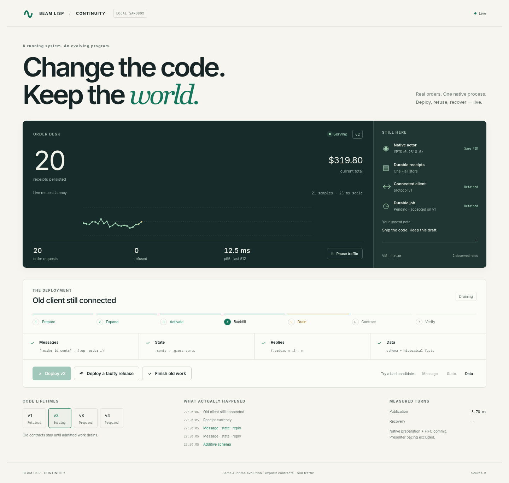
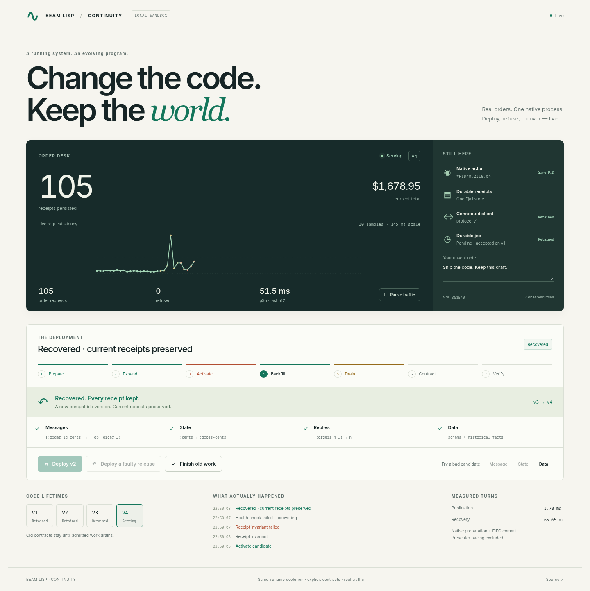
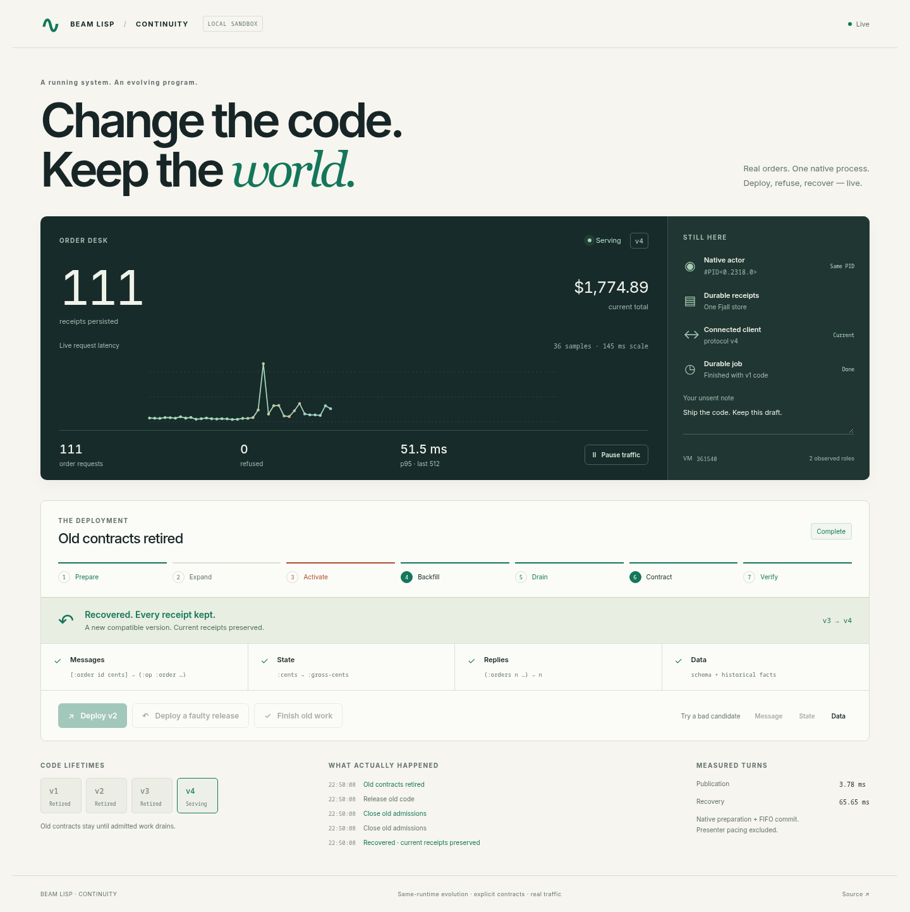
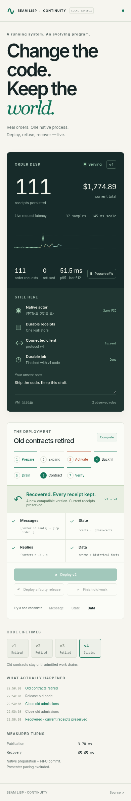

#+TITLE: Continuity — native evolution, recovery and measured admission
#+DATE: 2026-10-13
#+STATE: SDK / CONSUMERS / STANDALONE BROWSER ACCEPTED — sandbox only

* The demonstration
[[file:../../../examples/continuity/README.org][Presenter guide and reproduction]]. One real native actor accepts orders into
one Fjall receipt store while immutable callbacks evolve. Message/state/data
counterexamples refuse before actor activation. The retained v1 client keeps its
old reply contract. A semantic accounting fault passes shape checks, is detected
after activation and is corrected by a compatible newer version from current
receipts. A real pending v1 queue job runs with v1 code before that graph retires.
The native PID, VM, receipt store and browser draft/DOM node survive the journey.

No animation invents orders or latency. Presenter pacing happens outside the
actor/writer and is excluded from publication-turn measurements. Old graphs
remain until native clients, queue handlers/jobs and the retained callback drain.
This source demo has an intentionally small fixed control harness; it is not
full sealed Knowledger publication or native SDK/OS handover acceptance.

* Reusable changes
- 11568579: exact retained candidate preparations; opaque owner-local tickets;
  sampled message/state rehearsal; revision-bound FIFO commit, cancellation and
  idempotent lost-reply reconciliation. One outstanding preparation bounds memory.
- 5b96ab88: lexical managed client borrowing without a distributed request lock.
- 984301e0: single-turn synchronous native admission/dispatch/reply. Version
  fences remain native; async/durable lifetimes still need explicit dependencies.
- b4c340ad: fix retained queue diagnostics across real generation Envs. Carry
  linkage/claim IDs while retaining executing-Env sinks/schemas/capabilities.
  Keep the ordinary cross-Env captured-scope guard strict.
- 61c33fea: retain and check original/intermediate old input contracts before
  every adapter. Malformed legacy inputs cannot be sanitized into valid requests.
- bc7446ee: source coherence, deferred loading and codebase facts share native
  core/sugar fallback names; sealed business code needs no arbitrary exemption.
- b4fa9f21: bounded request-admission retry at producer protocol handoff, only
  for a known pre-effect refusal and an actually changed producer version.
- Foundry: durable guarded compensation, explicit source-only health declarations,
  exact receipted restart targets, truthful recovered history/status and live UI.
  Stateful general recovery remains an explicit compatible transformation.

* Admission benchmark
Raw distributions: [[file:CLIENT-ADMISSION.json]]. Driver:
[[file:../../../bench/proc-client-leases.bl]]. Functional source c504a3084d799134ac21fe8851a528f2c06f8631.
One VM/actor/Fjall store, one repeatedly updated entity; six ABCCBA batches,
three synchronized senders ×12writes/batch;72timed requests per strategy.
Twelve warmup writes plus216measured writes yield the verified persisted counter228.
Timers exclude startup and warmup. Whole invocation21.350s,CPU24.712s,215.3MiB
peak,zero swap. No provider, browser, source publication or crash occurs here.

| Strategy | p50 ms | p95 ms | Maximum ms | Wall ms for72writes |
| Shared client + distributed request lock |3.167|64.625|226.266|428.535|
| Lexical client acquire/call/release |7.950|12.540|13.276|193.528|
| Native synchronous request |8.208|12.736|17.798|203.658|

Native request p95is5.07×lower and sampled maximum12.71×lower than the lock
reference. Aggregate measured throughput is2.10×higher. Median is2.59×higher:
concurrent callers fairly share the actor queue, rather than long waits outside
it while one caller issues several writes. This is a tail/throughput tradeoff,
not a universal per-request speedup. Lexical and native paths have similar
latency here; the native path reduces public calls/bookkeeping, not a separately
proven CPU ratio. History/file-system effects remain; ABCCBA balances ordering.

The earlier order-desk aggregation experiment recomputed a growing receipt set
and is kept in HOME scratch as diagnostic evidence, not the primary benchmark.
The first driver invocation also had an invalid source label and is excluded.
The final driver requires an exact40-character source identity and records its
own source SHA. Fixed active data avoids confounding admission with growing
aggregate scans. These numbers do not predict Knowledger navigation latency.

* Final acceptance and screenshots
The official SDK from frozen source f5ecb6fd passes twelve files / 403 assertions,
including preparations, malformed old inputs, real-generation queue callbacks,
concurrent writes during drain, inferred/durable schema and actual Node guards.
Foundry on ordinary selected SDK passes twelve files / 1,185 assertions; Knowledger
passes five consumer files / 119 assertions. See [[file:SDK-ACCEPTANCE.org][exact build and provenance]],
[[file:SDK-TESTS.txt][packaged native result]] and the consumers' continuity evidence directories.
No stdlib checkout override supplies SDK tests or consumer runtime libraries.

Actual Chromium source-demo journey: one worker, 7.9 s, no retries, no page errors.
Source HEAD b4fa9f21d2a062ecb616ca08f7b7c301532fcc3f (includes unrelated civil-time
commit 27e71154; this does not relabel the frozen SDK source cut).
75 independent concurrent HTTP writes during fault/recovery, zero refusals;
HTTP p50 27.793 ms, p95 58.337 ms, maximum 158.694 ms. Same native PID/VM,
old-client replies, unchanged draft/DOM node, recovery from current receipts,
actual v1 durable-job result, eventual old graph retirement, keyboard/mobile/
reduced motion and same-origin mutation refusal all pass. Raw [[file:browser-results.json]].
Observed native prepare+commit 3.777 ms, recovery 65.652 ms; presenter pacing is
excluded. These are this small fixture's observations, not production SLOs.
Source server peak 296,312,832 bytes; CPU 40.294 s including startup/journey.
The verifier stopped its owned listener; roots/logs remain HOME-local.

Reviewed screenshots:
- .
- .
- .
- .
- .

Foundry's actual native actor/Fjall/journal browser gate uses the ordinary SDK,
not injected upgrade snapshots. Its final screenshots and independent result are
in Foundry !tasks/evidence/continuity. The browser catalog/step fixture is synthetic;
it does not replace packaged Knowledger acceptance. Generic HTTP measurements
stay Unmeasured rather than being inferred from native actor counters.
The Veritas model witnesses 256 histories with non-vacuity coverage assertions;
this is sampled evidence, not a universal proof. The actual lifecycle health test
also proves recovered journal target selection against a stale restart pointer.

* Remaining product gates
Ordinary server dispatch/restart factories, all future producers/sessions,
compiled request/reply/state inference and proof authority, full application
source closure, large/derived schema validation, legacy/provider reconciliation,
configuration/key rotation, full live backup recovery and native VM replacement
remain in Foundry's PLAN-hera-online-readiness.org. No Hera deployment occurs.
The demo's standalone coordinator is not a crash-durable journal. Foundry owns
that layer; unsettled arbitrary compensation still requires trusted preboot
reconciliation. Never restore a stale state snapshot or blindly repeat effects.
